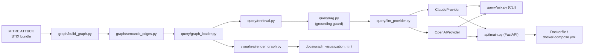

# CLAUDE.md

## Project

A knowledge-graph prototype over 13 MITRE ATT&CK techniques and 3
threat groups (APT29, APT28, Lazarus Group), modeled as a NetworkX
MultiDiGraph. On top of MITRE's structural data it records one kind of
fact: **which technique followed which, for one group, in one cited
report**. Each such semantic edge carries a source URL, a verbatim
quote, an incident ID and a confidence judgment. A retrieval layer
looks edges up deterministically; an optional LLM formats the
retrieved facts, behind a deterministic guard.

Scoped proof-of-concept, not a platform. No live CTI ingestion, no
extraction pipeline, no detection or mitigation data. **5 semantic
edges** exist after the 2026-10-26 audit (docs/edge-audit.md).

This is a consolidation-phase project. The open work is owning and
verifying what exists, not adding to it. Before adding an edge, data
source, provider or feature, check that the request is explicit.

## Architecture

Hand-authored pipeline diagram (update by hand when the pipeline
changes - not touched by `graph/generate_diagrams.py`):

- `graph/build_graph.py` - structural nodes/edges (Technique, Tactic,
  Group; HAS_TACTIC, USES_TECHNIQUE) from the official STIX bundle via
  `mitreattack-python`. 26 nodes, 54 edges.
- `graph/semantic_edges.py` - `SEMANTIC_EDGES`, the hand-authored
  TEMPORALLY_PRECEDES / CAUSALLY_ENABLES edges, as Python data. Field
  definitions are in its module docstring. Output:
  `data/graph_with_semantics.json`, 26 nodes, 59 edges (54 structural,
  4 CAUSALLY_ENABLES, 1 TEMPORALLY_PRECEDES). Committed, so the API and
  Docker image never need the STIX bundle.
- `graph/seed_config.py` - the fixed seed set (docs/decisions/001).
- `query/retrieval.py` - `get_technique_context()` / `format_context()`
  for one technique's structural usage and directly connected semantic
  edges; `get_chain_context()` / `format_chain_context()` for 2+
  techniques in order, via bounded BFS (max 4 hops). **Each chain path
  uses one group's edges only**; unfiltered queries return one path per
  group side by side, and a path whose hops come from different
  incidents is flagged in the facts block (docs/decisions/008, 009).
  Pure Python, no LLM. The facts block prints each edge's group,
  confidence, sample_size, incident, quote and URL.
- `query/rag.py` - FACTS go in the system message, the question in the
  user message (docs/decisions/005). Every reply passes two
  deterministic guards before it is returned, or `answer()` raises:
  `_check_no_ungrounded_techniques()` (every technique ID in the reply
  appears in FACTS) and `_check_no_ungrounded_edges()` (every edge the
  reply asserts exists in FACTS, under a group FACTS records for it,
  with any stated confidence/sample_size matching the stored value).
  What it misses is in ADR 005's 2026-10-26 Known limitations.
- `query/llm_provider.py` - `LLMProvider` interface (one method,
  `generate()`); `ClaudeProvider` (implemented, never live-tested here)
  and `OpenAIProvider` (live-tested). `has_credentials()` lets the CLI
  and API degrade to facts-only when no key is set.
- `query/ask.py` - CLI, `python -m query.ask "..."`. Technique IDs and
  group names are extracted with regex, not an LLM (docs/decisions/003).
- `api/main.py` - FastAPI wrapper over the same functions: `POST /query`,
  `GET /health`, `GET /techniques` (docs/decisions/007).
- `visualize/render_graph.py` - pyvis HTML of the combined graph.
- `tests/` - see Testing below.
- `docs/edge-audit.md` - per-edge source, quote, incident ID and
  status (VERIFIED / REMOVED) from the 2026-10-26 audit.
- `docs/OWNERSHIP.md` - the owner's closed-book explanation notes.
- `docs/decisions/` - ADRs 001-010. Amended ADRs keep their original
  text and add a dated amendment; they are not rewritten.
- `docs/attack-patterns/` - one case file per seed technique. Their
  prose predates the audit; each starts with a dated audit note listing
  which of its edges were kept or removed.
- `docs/security-assessment.md` - append-only, dated red-team log.
- `docs/future/` - design-only notes, unbuilt and not planned.
- `ingestion/` - does not exist; no extraction pipeline is in scope.
- `NOTES-private.md` - gitignored personal notes; never referenced.

### Diagrams: auto-generated vs. hand-authored

Two categories, unambiguous by construction (see
`.claude/skills/generate-diagrams/SKILL.md` for the full contract):

- **Auto-generated** (never hand-edit - rerun `graph/generate_diagrams.py`
  instead; each lives inside `<!-- BEGIN GENERATED -->` /
  `<!-- END GENERATED -->` markers): the `## Flow` section in every
  `docs/attack-patterns/<ID>-*.md` case file, and the kill-chain diagram
  under README.md's "Technique Relationship Graph" section.
- **Hand-authored** (update manually when the architecture changes; no
  `GENERATED` markers, never touched by the script): the system
  architecture diagram above and in README.md's "Architecture" section,
  the query-flow sequence diagram in docs/decisions/003-query-layer-
  scope.md, and the provider-abstraction class diagram in
  docs/decisions/004-llm-provider-abstraction.md.

## Conventions

- **Every semantic edge has a fetchable `source_url`, a `source_date`,
  a verbatim `quote` (under 25 words) that narrates that specific order
  or dependency for that group, and an `incident_id`.** Co-citation
  (two techniques named in the same report) is not evidence of order.
  An edge that is true by definition (e.g. attachment delivered, then
  opened) is not added. No invented data.
- `confidence` is the author's judgment of how directly the quote
  supports the edge, explained in `evidence`. `sample_size` counts only
  sources that narrate the claim themselves.
- Structural data comes from `mitreattack-python`, never authored.
- A guard or test claim describes exactly what is tested. Never write
  that a guard "closes" a class of attack; list what it misses.
- ADRs and BUILD_LOG.md are append-only records. Correct them with a
  dated amendment, never a silent edit.

## Adding or changing an edge

1. Fetch the primary source. If it cannot be fetched, the edge cannot
   be added.
2. Find the sentence that narrates A-then-B (or A-enables-B) for this
   group in one operation. Copy it verbatim, under 25 words, into
   `quote`, with `source_url`, `source_date` and `incident_id`.
3. Check the group: the source must attribute the activity to the seed
   group itself, as MITRE ATT&CK names it (e.g. Andariel is not
   Lazarus Group). Check the technique: the quoted behavior must be
   that technique ID, not a neighbor (e.g. exfiltration to cloud
   storage is T1567, not T1071.001).
4. Write `evidence` in your own words, saying what is inferred rather
   than stated. Set `confidence` accordingly.
5. Add or update the row in `docs/edge-audit.md`.
6. Run `python -m graph.semantic_edges`, `python -m graph.generate_diagrams`,
   `python -m visualize.render_graph`, then the full test suite.
7. Opus-tier review (see Model Usage) for the confidence call and any
   conflicting sources.

## Testing

Run `python -m pytest tests/` from the repo root before every commit.
CI (`.github/workflows/test.yml`) rebuilds both graph JSON files from
the STIX bundle and runs the same suite on every push and PR to `main`.

- `test_rag_guard.py` - the guards, deterministic. Includes the four
  2026-10-26 review probes (fabricated confidence, wrong group, passive
  voice, cue-excused edge) through the real `answer()` with a stub
  provider, plus false-positive checks (every real FACTS block passes
  its own guard). To harden the guard: add the probe as a failing test
  first, then fix, then update ADR 005's Known limitations.
- `test_chain_retrieval.py` - chains on the real graph, plus a small
  synthetic fixture graph for behavior 5 edges cannot exercise
  (cross-group stitching, two groups on one pair, cross-incident paths).
- `test_api.py` - FastAPI `TestClient`, no LLM.
- `test_fetch_test_logs_safety.py` - path-traversal guard in the
  fetch-test-logs skill script.
- `test_adversarial_queries.py` - live LLM, skips without a key.
- `test_query_layer_against_evtx.py` - real atomic-evtx samples, skips
  until `.claude/skills/fetch-test-logs/fetch_test_logs.py --fetch` is run.

Last full run (2026-10-26): 45 passed, 7 skipped (the live-LLM and
EVTX files), 0 failed.

## Code Review Standards

Patterns to apply going forward, not a list of past mistakes:

- Extract repeated lookup/extraction logic into a named helper function
  rather than inlining a generator expression or nested loop in the
  middle of graph-building code. A helper with a clear name documents
  intent at the call site and gives the logic one place to fix.
- Prefer an early-exit loop over `next(generator, default)` for "find
  the first match" logic - easier to read and to extend if the match
  condition ever needs to grow past a single comparison.
- Use `collections.Counter` for type-counting patterns instead of a
  manually maintained `dict` with `.get(key, 0) + 1`.
- Don't add complexity (custom JSON encoders, filtering/indexing layers,
  etc.) to solve a problem that hasn't actually occurred - verify first
  (e.g. does `json.dumps()` actually fail without a `default=`
  fallback?) before reaching for a more complex solution.
- Performance tradeoffs that are fine at the current scale (e.g. loading
  the full STIX bundle into memory on every run, appropriate for 13 seed
  techniques) should be left alone, with a one-line comment marking them
  as an accepted tradeoff and naming the condition that would make them
  worth revisiting - not solved preemptively.

## Model Usage

Convention for which Claude model tier to use on this project, going
forward - apply this without being re-asked. Match the tier to the task
below (via `/model` for the session, or the `model` param on a spawned
Agent/subagent for a single sub-task) rather than defaulting to one
model for everything.

- **Haiku 4.5** - mechanical, single-correct-answer tasks: running or
  re-running `graph/build_graph.py` / `graph/semantic_edges.py` and
  reading off the node/edge counts, environment/dependency
  troubleshooting (e.g. venv setup), formatting-only edits, and
  BUILD_LOG entries whose content has already been decided and just
  needs writing up. These have an immediately checkable outcome (the
  script runs or it doesn't; the count matches or it doesn't), so
  reasoning depth buys little - speed and cost efficiency matter more.
- **Sonnet 5** (default) - the bulk of the project: implementing graph/
  ingestion code, drafting attack-pattern case files and ADRs once the
  supporting sources are already in hand, general web research and
  citation gathering, routine edits and code review. Sustained
  engineering work that needs solid reasoning and code quality but isn't
  the highest-stakes judgment call in the pipeline.
- **Opus 5** - high-stakes reasoning where a subtle mistake becomes
  invented or silently-wrong data baked into the graph: assigning
  `confidence`/`sample_size` to a semantic edge, designing or revising
  the semantic-edge schema itself (ADR-level architecture decisions),
  and reconciling conflicting or ambiguous evidence across multiple CTI
  sources before committing to an edge's direction. This project's
  credibility rests entirely on "no invented data" (see Conventions
  below) - these are exactly the spots where a plausible-sounding but
  wrong inference is hardest to catch after the fact, as happened once
  already this project (see BUILD_LOG.md, 2026-08-13 entry on the
  reversed T1059.001/T1021.001 edge) - so the extra reasoning depth is
  worth the cost here specifically, not project-wide.

## Adding an LLM Provider

1. Subclass `LLMProvider` in `query/llm_provider.py` and implement
   `generate(self, prompt, *, system=None) -> str`. Raise on failure;
   never return a placeholder.
2. Register it in `PROVIDERS` and its key env var in
   `CREDENTIAL_ENV_VARS`.
3. Run the red-team-assessment skill's LLM lens against it before
   calling it done: guard behavior is tested deterministically, but
   injection resistance is a property of the model.

Do not register a stub that can only raise (the KimiProvider stub was
removed on 2026-10-26, docs/decisions/004 amendment).

## Current status

- Phases built: structural graph, semantic edges (5 after the audit),
  query layer with grounding guards, multi-hop chains, FastAPI + Docker.
- 2026-10-26 consolidation (senior-security-engineer review): guard
  hardened against four probes (ADR 005 amendment); chains made
  single-group with incident warnings (ADR 009); all 17 edges
  re-audited, 12 removed (ADR 010, docs/edge-audit.md); cross-group
  comparisons and the Kimi stub removed (ADR 006 superseded, ADR 004
  amendment); README overclaims removed.
- Verified: `OpenAIProvider` end to end (2026-08-13); Docker build/run
  (2026-08-15); everything in the deterministic test suite.
- Not verified: `ClaudeProvider` against a live key; the audit's quotes
  character by character against the source pages (they came through a
  summarising fetch tool); the guard against models other than gpt-5.1.
- Environment: on the owner's Kali machine use the project `.venv`
  (system Python is externally managed). STIX bundle download command
  is in README's Quick Start.
- Next, in order: the owner explains the 5 edges, the guard and the
  chain rules closed-book (docs/OWNERSHIP.md); spot-check the 5 quotes
  against the sources by hand. Open questions parked in
  docs/edge-audit.md's "Open for Venu" are decisions, not tasks.

## Do NOT

- Don't add an edge, data source, provider or feature during a
  consolidation pass. Park it in docs/edge-audit.md or BUILD_LOG.md as
  a decision for the owner.
- Don't describe the graph as covering detection, mitigation, tooling
  or prediction. It covers cited technique order, per group.
- Don't present a multi-hop path as an observed intrusion unless every
  hop shares an incident.
- Don't reproduce platform-pitch language (multi-agent ingestion,
  validators, roadmaps) as if built or imminent.
- Don't add real API keys/secrets anywhere.
- Don't invent confidence scores, quotes or campaign details.
