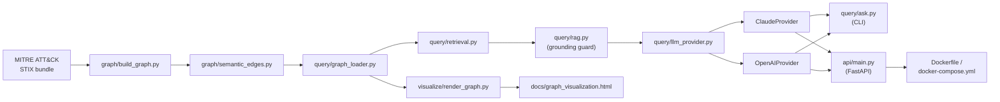
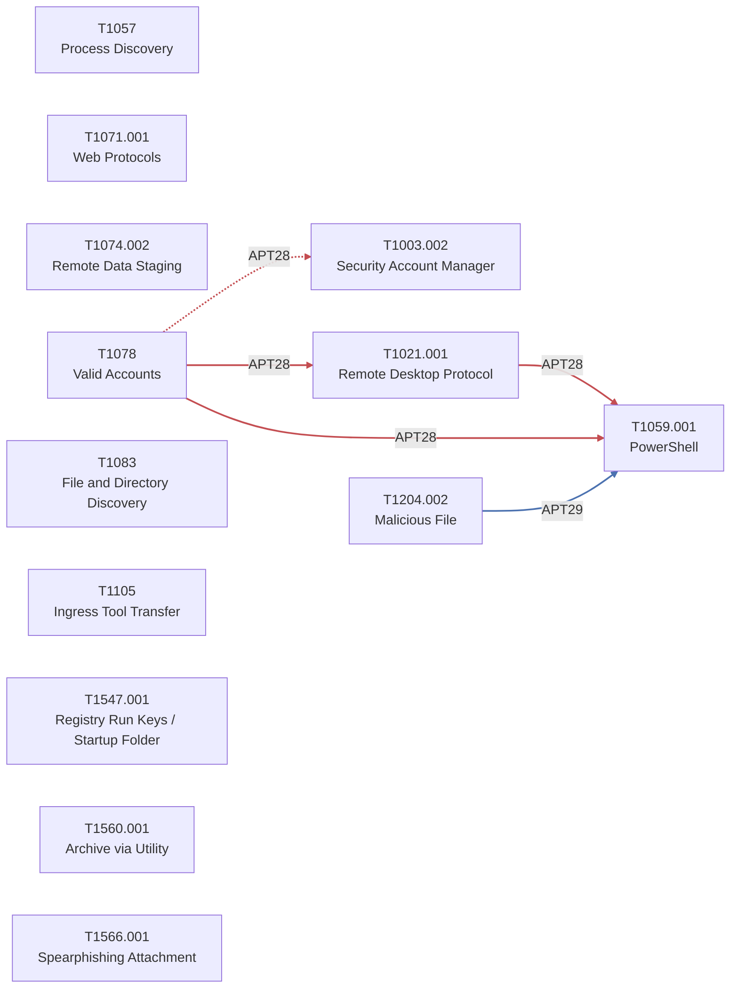

# attck-graph

[](https://www.python.org/)
[](https://networkx.org/)
[](https://github.com/HungryBrain-bot/attackKnowledgeGraph/actions/workflows/test.yml)
[](LICENSE)

A small knowledge-graph prototype over 13 MITRE ATT&CK techniques and 3
threat groups. It records one kind of fact that ATT&CK itself does not:
**which technique followed which, for a specific group, in a specific
cited report.** Each such edge carries the source URL, a short verbatim
quote, the incident it came from, and the author's confidence. A
retrieval layer looks those edges up deterministically, and an optional
LLM rewrites the retrieved facts as a short answer, with a guard that
rejects some kinds of fabricated output.

It currently holds **5 cited edges** (4 for APT28, 1 for APT29), after a
2026-10-26 audit removed 12 of the original 17 that their sources did
not support. See [docs/edge-audit.md](docs/edge-audit.md).

## What this does NOT do

Read this before anything else in the repo:

- **It does not say how to detect a technique**, what telemetry is
  needed, or whether any detection covers it. There is no detection or
  coverage data in the graph. `docs/future/detection-coverage.md` is an
  unbuilt design note, not a feature.
- **It does not say what mitigates a technique** or which tools or
  malware a group uses.
- **It does not predict what an attacker will do next.** An edge says
  "in this one cited report, this group did A, then B". It is not a
  probability, and 5 edges are far too few to generalise from.
- **A multi-hop chain is not an observed intrusion** unless every hop
  comes from the same incident. Chains never mix groups, and the facts
  block warns when a chain joins incidents (ADR 009).
- **The confidence numbers are one author's judgment** of how directly
  the quote supports the edge, not a statistic.
- **The LLM guard is not a hallucination detector.** It catches
  specific, tested shapes of fabricated edges and attributes; it misses
  free prose and fabricated sources. See its
  [Known limitations](docs/decisions/005-prompt-injection-fact-separation.md#known-limitations-what-the-guard-still-does-not-catch).
- **No live CTI ingestion, no extraction pipeline, no production use.**
  Every edge is hand-authored. `ClaudeProvider` has never been run
  against a live key; only `OpenAIProvider` has.

## See it run

Real output from `python -m query.ask` against the current graph, with
no LLM key configured (lines truncated with `[...]`):

```
$ python -m query.ask "what happens after T1078 for APT28?"

--- Retrieved facts (from the graph, not the LLM) ---
TECHNIQUE: T1078 - Valid Accounts
Tactics: stealth, persistence, privilege-escalation, initial-access
[...]
Semantic edges (filtered to group: APT28):
  - [APT28] T1078 --CAUSALLY_ENABLES--> T1021.001 (Remote Desktop Protocol)
    confidence: 0.85, sample_size: 1, incident: nearest-neighbor-2022,
    sources: Volexity Nearest Neighbor Attack Nov 2024
    quote: "after an attacker used privileged credentials to connect to it
    via RDP from another system within Organization B’s network" (https://www.volexity.com/[...])
  - [APT28] T1078 --TEMPORALLY_PRECEDES--> T1003.002 (Security Account Manager)
    confidence: 0.75, sample_size: 1, incident: nearest-neighbor-2022, [...]
  - [APT28] T1078 --CAUSALLY_ENABLES--> T1059.001 (PowerShell)
    confidence: 0.7, sample_size: 1, incident: gru-brute-force-campaign-2019-2021, [...]

(No LLM provider credentials configured - showing retrieved facts only. [...])
```

Everything above comes from graph traversal, not an LLM. With a key in
`.env`, an `--- Answer ---` section follows, written by the LLM from
these facts only and checked by the guard before it is returned.

## Known limitations

- **Edges**: 5, from 3 reports. Lazarus Group has none. Quotes were
  extracted with a summarising fetch tool and not yet compared character
  by character against the sources ([docs/edge-audit.md](docs/edge-audit.md)).
- **Guard** ([ADR 005, 2026-10-26 amendment](docs/decisions/005-prompt-injection-fact-separation.md)):
  checks edge existence, group, confidence and sample_size against the
  stored facts. Misses edges stated in free prose, groups named in a
  different sentence, fabricated sources, and other attribute phrasings.
  Fails closed: a correct refusal that repeats a fabricated edge without
  quoting it raises an error.
- **Chains** ([ADR 009](docs/decisions/009-single-group-chains.md)):
  one group per path, BFS capped at 4 hops; incident labels are only as
  good as the audit.
- **Tests**: CI runs the deterministic tests only. The live-LLM
  adversarial tests and the EVTX telemetry tests skip without
  credentials or fetched logs.
- **API**: request-size check reads `Content-Length` only, so a chunked
  body is not limited (docs/security-assessment.md).

## Architecture

Hand-authored (module structure, not graph data); update by hand when
the pipeline changes.



- **Structural layer**: techniques, tactics, groups and `USES_TECHNIQUE`
  edges, built from MITRE's official STIX bundle via `mitreattack-python`.
- **Semantic layer**: hand-authored `TEMPORALLY_PRECEDES` /
  `CAUSALLY_ENABLES` edges in `graph/semantic_edges.py`, each scoped to
  one group and one incident, with source URL and quote.
- **Retrieval** (`query/retrieval.py`): one technique's edges, or a
  bounded BFS chain between 2+ techniques. No LLM.
- **Answer** (`query/rag.py`): facts go in the system message, the
  question in the user message, and the reply is checked by
  `_check_no_ungrounded_techniques()` and `_check_no_ungrounded_edges()`
  before it is returned.

[Interactive graph visualization](docs/graph_visualization.html) -
open locally in a browser (GitHub does not run its JavaScript).

## Technique Relationship Graph

Auto-generated from `data/graph_with_semantics.json` by
`graph/generate_diagrams.py` - don't hand-edit the block below; rerun
the generator instead.

<!-- BEGIN GENERATED: graph/generate_diagrams.py (do not hand-edit; rerun the script) -->


*Edge color by group: APT28 = `#C44E52`, APT29 = `#4C72B0`, Lazarus Group = `#55A868`. Dashed = TEMPORALLY_PRECEDES, solid = CAUSALLY_ENABLES.*
<!-- END GENERATED -->

## Repository structure

```
graph/
  build_graph.py        STIX bundle -> structural MultiDiGraph
  semantic_edges.py     the 5 audited, cited semantic edges
  seed_config.py        fixed seed set: 3 groups, 13 techniques
  generate_diagrams.py  Mermaid diagrams from the built graph
query/
  graph_loader.py       loads data/graph_with_semantics.json
  retrieval.py          single-technique and multi-hop chain retrieval (no LLM)
  rag.py                prompt construction + deterministic grounding guards
  llm_provider.py       LLMProvider interface; ClaudeProvider, OpenAIProvider
  ask.py                CLI: python -m query.ask "..."
api/main.py             FastAPI wrapper: POST /query, GET /health, GET /techniques
visualize/              pyvis visualization -> docs/graph_visualization.html
tests/                  deterministic tests (guard probes, chains, API, path safety)
                        + live-LLM and EVTX tests that skip without credentials/logs
docs/
  edge-audit.md         per-edge source, quote, incident, status (2026-10-26)
  OWNERSHIP.md          closed-book explanation notes for the project owner
  decisions/            ADRs 001-010
  attack-patterns/      one case file per seed technique (pre-audit prose, dated notes)
  security-assessment.md  dated red-team findings log
  future/               design-only, unbuilt notes
.claude/skills/         Claude Code skills used to build this repo
skills-playbook/        generalized versions of those skills
```

## Quick Start

```bash
git clone https://github.com/HungryBrain-bot/attackKnowledgeGraph.git
cd attackKnowledgeGraph
python3 -m venv .venv && .venv/bin/pip install -r requirements.txt

# official MITRE ATT&CK STIX bundle (~48MB, gitignored)
mkdir -p data/raw && curl -o data/raw/enterprise-attack.json \
  https://raw.githubusercontent.com/mitre/cti/master/enterprise-attack/enterprise-attack.json

.venv/bin/python -m graph.build_graph       # -> data/structural_graph.json
.venv/bin/python -m graph.semantic_edges    # -> data/graph_with_semantics.json
.venv/bin/python -m pytest tests/           # deterministic tests; LLM/EVTX tests skip

# optional: an LLM key for a formatted answer (facts-only without one)
echo 'ANTHROPIC_API_KEY=sk-ant-...' > .env
# or: echo 'OPENAI_API_KEY=sk-...' > .env && echo 'LLM_PROVIDER=openai' >> .env

.venv/bin/python -m query.ask "what happens after T1078 for APT28?"
.venv/bin/python -m query.ask "T1078 then T1021.001 then T1059.001 for APT28"
```

After editing `graph/semantic_edges.py`, also run
`python -m graph.generate_diagrams` and `python -m visualize.render_graph`.

### Docker

The built graph JSON is committed, so the container needs neither the
STIX bundle nor a venv (docs/decisions/007):

```bash
docker compose up --build
curl -X POST http://localhost:8000/query -H "Content-Type: application/json" \
  -d '{"question": "what happens after T1078 for APT28?"}'
```

## How it was built

Built with Claude Code under project skills (`.claude/skills/`) that
require an ADR for each real decision, a dated build log, and a check
before anything is called verified. Those rules did not stop the
problems the 2026-10-26 review found: overstated guard claims in ADR
005, mixed-group chains, and citations that did not support their
edges. The fixes are in ADRs 005 (amendment), 009 and 010, and the
build procedure now requires a quote and URL per edge
([CLAUDE.md](CLAUDE.md), "Adding or changing an edge").

- [BUILD_LOG.md](BUILD_LOG.md) - dated, append-only log of every session
- [docs/decisions/](docs/decisions/) - ADRs
- [docs/security-assessment.md](docs/security-assessment.md) - red-team log
- [skills-playbook/](skills-playbook/README.md) - the skills, generalized

## Not built

Speculative design notes live in `docs/future/` (continuous CTI
ingestion, detection coverage, scaling). None is implemented or
planned, and each is gated by a skill's trigger conditions. Not built
either: a live test of `ClaudeProvider`, CI for the Docker image, and
any edge beyond the audited five.
